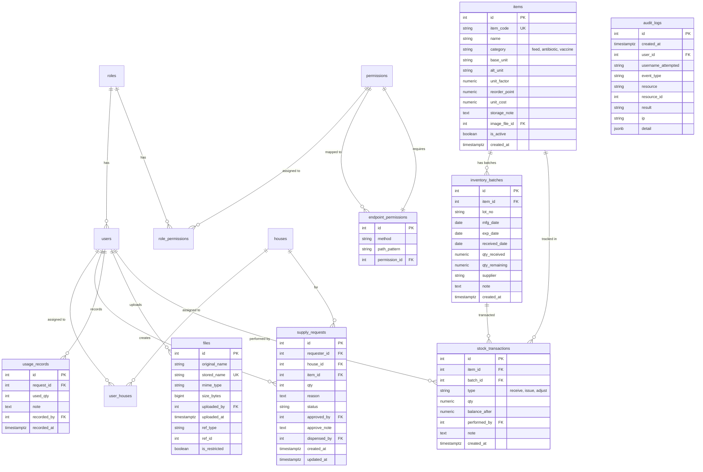

# ระบบบริหารฟาร์ม/โรงเรือน (Farm Management System)

## ภาพรวมระบบ
ระบบสำหรับจัดการการเบิกวัสดุ อาหาร ยา วัคซีนในฟาร์ม โดยมีกระบวนการอนุมัติที่ชัดเจน ติดตามสต็อกได้ และบันทึกประวัติการใช้งาน

### กระบวนการหลัก
1. คนงานส่งคำขอเบิก
2. เจ้าของฟาร์มพิจารณา อนุมัติ/ปฏิเสธ (ใส่เหตุผลเมื่อปฏิเสธ)
3. หัวหน้าโรงเรือนจ่ายของ (ตัดสต็อกจริง)
4. คนงานบันทึกการใช้
5. ทุกคนตรวจสอบสถานะได้ตามสิทธิ์

### สถานะคำขอ
- `pending` - รออนุมัติ
- `approved` - อนุมัติแล้ว
- `rejected` - ถูกปฏิเสธ
- `dispensed` - จ่ายของแล้ว
- `completed` - บันทึกการใช้แล้ว
- `cancelled` - ยกเลิก

## เทคโนโลยีที่ใช้
- **Backend**: Node.js + Express.js
- **Database**: PostgreSQL (ใช้ library `pg`)
- **Session**: PostgreSQL (connect-pg-simple)
- **Authentication**: bcrypt
- **File Upload**: multer + file-type
- **Security**: helmet, express-rate-limit
- **Validation**: zod
- **View Engine**: EJS
- **Environment**: dotenv

## โครงสร้างโฟลเดอร์
```
Project2/
├── config/              # การตั้งค่า (database, session, etc.)
├── controllers/         # Controllers สำหรับจัดการ logic
├── middleware/          # Middleware (auth, acl, validation, etc.)
├── routes/              # Route definitions
├── services/            # Business logic services
├── views/               # EJS templates
├── database/            # Schema และ seed data
│   ├── schema.sql
│   └── seed.sql
├── uploads/             # ไฟล์ที่อัปโหลด (นอก public)
├── public/              # Static files
├── .env                 # Environment variables (สร้างจาก .env.example)
├── .env.example         # Template สำหรับ .env
├── package.json
├── server.js            # Entry point
└── README.md
```

## วิธีติดตั้งและเริ่มใช้งาน

### 1. ติดตั้ง Dependencies
```bash
npm install
```

### 2. ตั้งค่า Environment Variables
คัดลอก `.env.example` เป็น `.env` และแก้ค่าตามเหมาะสม:
```bash
cp .env.example .env
```

แก้ไขค่าใน `.env`:
- `DB_HOST`, `DB_PORT`, `DB_NAME`, `DB_USER`, `DB_PASSWORD` - ข้อมูลเชื่อมต่อ PostgreSQL
- `SESSION_SECRET` - คีย์ลับสำหรับ session (ต้องเปลี่ยนใน production)
- `PORT` - พอร์ตที่จะรัน server (ค่าเริ่มต้น 3000)

### 3. สร้างฐานข้อมูล
```bash
# สร้างฐานข้อมูล
createdb farm_db

# รัน schema
psql -U postgres -d farm_db -f database/schema.sql

# รัน seed data
psql -U postgres -d farm_db -f database/seed.sql
```

### 4. เริ่ม Server
```bash
# Development mode (ใช้ nodemon)
npm run dev

# Production mode
npm start
```

เข้าใช้งานที่: http://localhost:3000

## บัญชีทดสอบ
| Username | Password | Role | คำอธิบาย |
|----------|----------|------|-----------|
| admin | test1234 | Admin | ผู้ดูแลระบบ - ทำได้ทุกฟังก์ชัน |
| owner1 | test1234 | Owner | เจ้าของฟาร์ม - ผู้อนุมัติคำขอ |
| head1 | test1234 | Head | หัวหน้าโรงเรือน - จ่ายของ จัดการสต็อก/โรงเรือนของตน |
| worker1 | test1234 | Worker | คนงาน - ยื่นคำขอและบันทึกการใช้ของตนเอง |
| worker2 | test1234 | Worker | คนงาน - ยื่นคำขอและบันทึกการใช้ของตนเอง |

## ER Diagram



## ความสัมพันธ์ผู้ใช้–บทบาท–สิทธิ์–ข้อมูลระบบงาน

### 1. ผู้ใช้ (Users)
- แต่ละผู้ใช้มี Role เดียว
- ผู้ใช้สามารถสังกัดโรงเรือนได้หลายแห่ง (ผ่าน user_houses)
- คนงานและหัวหน้าโรงเรือนต้องสังกัดโรงเรือนอย่างน้อย 1 แห่ง

### 2. บทบาท (Roles)
- **Admin**: ทำได้ทุกฟังก์ชัน (is_system=true)
- **Owner**: อนุมัติ/ปฏิเสธคำขอเบิก ดูข้อมูลทั้งหมด
- **Head**: จ่ายของ จัดการสต็อก/โรงเรือนที่ตนสังกัด
- **Worker**: ยื่นคำขอ บันทึกการใช้ ดูข้อมูลของตน

### 3. สิทธิ์ (Permissions)
- แต่ละ Role มี Permissions หลายอัน (ผ่าน role_permissions)
- Permission ถูกจัดกลุ่มตาม module (user, role, house, supply, request, file, log, etc.)
- Permission ผูกกับ Endpoint ผ่าน endpoint_permissions
- Admin ผ่านทุก Permission โดยอัตโนมัติ

### 4. ข้อมูลระบบงาน
- **Houses**: โรงเรือน - คนงาน/หัวหน้าโรงเรือนสังกัดโรงเรือนเหล่านี้
- **Supply Items**: วัสดุ/อาหาร/ยา/วัคซีน - มีสต็อกและแจ้งเตือนเมื่อต่ำกว่า min_qty
- **Supply Requests**: คำขอเบิก - มีสถานะและประวัติการอนุมัติ/จ่าย/ใช้
- **Usage Records**: บันทึกการใช้ - เชื่อมกับคำขอเบิก

## Access Matrix

| ฟังก์ชัน | Admin | Owner | Head | Worker |
|-----------|-------|-------|------|--------|
| **ผู้ใช้** |
| ดูข้อมูลผู้ใช้ | ✅ | ✅ | ❌ | ❌ |
| เพิ่มผู้ใช้ | ✅ | ❌ | ❌ | ❌ |
| แก้ไขผู้ใช้ | ✅ | ❌ | ❌ | ❌ |
| ลบผู้ใช้ | ✅ | ❌ | ❌ | ❌ |
| **บทบาท** |
| ดู/เพิ่ม/แก้/ลบ Role | ✅ | ❌ | ❌ | ❌ |
| เปลี่ยน Role ผู้ใช้ | ✅ | ❌ | ❌ | ❌ |
| **สิทธิ์** |
| ดู/เพิ่ม/แก้/ลบ Permission | ✅ | ❌ | ❌ | ❌ |
| จัดการ ACL (Role-Permission) | ✅ | ❌ | ❌ | ❌ |
| ผูก Permission-Endpoint | ✅ | ❌ | ❌ | ❌ |
| **โรงเรือน** |
| ดูโรงเรือน | ✅ ทั้งหมด | ✅ ทั้งหมด | ✅ ของตน | ✅ ของตน |
| เพิ่มโรงเรือน | ✅ | ✅ | ❌ | ❌ |
| แก้ไขโรงเรือน | ✅ | ✅ | ✅ ของตน | ❌ |
| ลบโรงเรือน | ✅ | ✅ | ❌ | ❌ |
| **วัสดุ** |
| ดูวัสดุ | ✅ ทั้งหมด | ✅ ทั้งหมด | ✅ ทั้งหมด | ✅ ทั้งหมด |
| เพิ่มวัสดุ | ✅ | ✅ | ❌ | ❌ |
| แก้ไขวัสดุ | ✅ | ✅ | ✅ | ❌ |
| ลบวัสดุ | ✅ | ✅ | ❌ | ❌ |
| **คำขอเบิก** |
| ดูคำขอ | ✅ ทั้งหมด | ✅ ทั้งหมด | ✅ ของโรงเรือนตน | ✅ ของตน |
| สร้างคำขอ | ✅ | ❌ | ❌ | ✅ |
| แก้ไขคำขอ | ✅ | ❌ | ❌ | ✅ ของตน (pending) |
| ยกเลิกคำขอ | ✅ | ❌ | ❌ | ✅ ของตน (pending) |
| อนุมัติคำขอ | ✅ | ✅ | ❌ | ❌ |
| ปฏิเสธคำขอ | ✅ | ✅ | ❌ | ❌ |
| จ่ายของ | ✅ | ❌ | ✅ ของโรงเรือนตน | ❌ |
| บันทึกการใช้ | ✅ | ❌ | ❌ | ✅ ของตน |
| **ไฟล์** |
| อัปโหลดไฟล์ | ✅ | ❌ | ❌ | ✅ |
| ดาวน์โหลดไฟล์ | ✅ | ✅ | ✅ | ✅ (ตามเงื่อนไข) |
| ลบไฟล์ | ✅ | ❌ | ❌ | ❌ |
| **Log** |
| ดู Audit Log | ✅ | ✅ | ❌ | ❌ |
| **รายงาน** |
| ดูรายงานการใช้ | ✅ | ✅ | ✅ | ❌ |

## ข้อจำกัดของระบบ
- ห้ามลบ Role ที่ยังมีผู้ใช้อยู่
- ห้ามลบ/ลดสิทธิ์ Role Admin
- ห้ามเปลี่ยน Role/ปิดบัญชี/ลบผู้ใช้ที่ทำให้ไม่มี Admin เหลือ
- คนงานแก้/ยกเลิกได้เฉพาะคำขอของตนที่ยัง pending
- หัวหน้าโรงเรือนเห็น/จ่ายได้เฉพาะโรงเรือนที่สังกัด
- จ่ายของต้องมีสต็อกเพียงพอ (ห้ามติดลบ)
- ไฟล์ที่อัปโหลดต้องเป็น jpg, png, pdf และไม่เกิน 2MB
